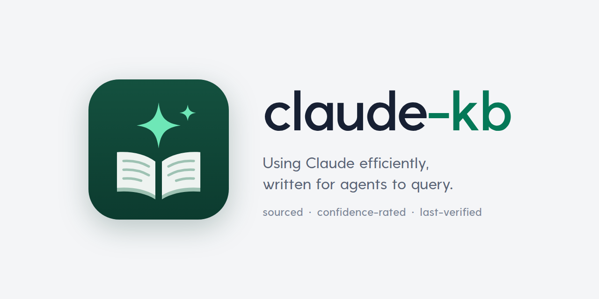

<p align="center">
  <picture>
    <source media="(prefers-color-scheme: dark)" srcset="assets/banner-dark.png">
    
  </picture>
</p>

<p align="center">
  <a href="https://github.com/FreekMencke/claude-kb/actions/workflows/check.yml"></a>
  &nbsp;
  <a href="https://github.com/FreekMencke/claude-kb/actions/workflows/mcp-server.yml"></a>
  &nbsp;
  <a href="https://github.com/FreekMencke/claude-kb/actions/workflows/deploy.yml"></a>
  &nbsp;
  <a href="mcp-server/README.md"></a>
</p>

A Markdown knowledge base on using Claude efficiently, and on the stack it works on (Angular, TypeScript, Node, npm,
NestJS, MongoDB, lint and test tools, CSS, spacing and alignment, fonts, accessibility, charts and data visualisation, page layout, web performance and security, GitHub and its Actions,
Docker, Kubernetes, AWS Lambda, licences), written for agents to query. Every entry carries its sources, a confidence
level and a last-verified date.

## Setup

Claude reads the knowledge base through the `claude-kb-lookup` skill and the remote MCP server at
`https://claude-kb.freekmencke.com/mcp` ([mcp-server/README.md](mcp-server/README.md)), which is open to anyone
without a sign-in. The files can also be read [by hand](#by-hand).

| Where you ask | What to set up |
|---|---|
| claude.ai chat (web, desktop, phone), Cowork | [The plugin](#the-plugin) |
| Claude Code on your machine, desktop WSL included | [The plugin](#the-plugin), installed [from the command line](#in-claude-code) |
| Cloud sessions and routines | Nothing to install: [prefix the question](#cloud-sessions-and-routines) |

### The plugin

The `kb-lookup` plugin bundles the skill with the server, so chat looks things up without being told to (MCP-040).
This repo is its marketplace.

#### On claude.ai

For chat and Cowork:

1. On claude.ai (not the Code tab's Plugins page): Customize > Plugins > Add > Add marketplace.
2. Enter `FreekMencke/claude-kb` and turn on Sync automatically.
3. Install `kb-lookup`, then connect "Claude KB" on its Connectors tab.

Claude Code sessions signed in with claude.ai get it as `kb-lookup@synced` (SKILL-059), but desktop WSL sessions
didn't load that copy in a 2026-10-17 test (SKILL-063).

#### In Claude Code

Install it from the command line as well:

```bash
claude plugin marketplace add FreekMencke/claude-kb
```

```bash
claude plugin install kb-lookup@freek-kb
```

- The CLI names the marketplace `freek-kb`, the `name` in `.claude-plugin/marketplace.json`. `kb-lookup@claude-kb`,
  the name the claude.ai sync uses, fails.
- Auto-update is off for this marketplace (SKILL-036). Turn it on in `/plugin` > Marketplaces, or with
  `"autoUpdate": true` on the `freek-kb` entry of `extraKnownMarketplaces` in `~/.claude/settings.json`.
- This copy wins over `kb-lookup@synced`, so the skill is listed once.
- Its tools are named `mcp__plugin_kb-lookup_claude-kb__*` (MCP-009): allow that pattern in `permissions.allow`.

### The server at user scope

Optional, for the tools without the plugin's skill. The plugin's own server works in desktop WSL sessions too
(SKILL-063).

```bash
claude mcp add --transport http --scope user claude-kb https://claude-kb.freekmencke.com/mcp
```

- It wins over the plugin's copy of the same URL (MCP-009), so with both installed the tools are named
  `mcp__claude-kb__*`.
- It works in desktop WSL sessions, where claude.ai connectors are unreliable (MCP-010).
- It costs about 255 input tokens per request (MCP-039).

### Cloud sessions and routines

These load neither synced plugins nor `~/.claude` (SKILL-060). Either start the question with "KB:" so Claude uses the
"Claude KB" connector (MCP-038), or attach the FreekMencke/claude-kb repo so its `.claude/skills/` loads.

## Querying it

Ask the `claude-kb-lookup` skill, or in a cloud session start the question with "KB:". The skill runs as a forked
subagent that can't see your conversation, so give it a self-contained question, and keep the entry IDs it cites in
your reply.

Treat an entry last verified more than 60 days ago as a lead to re-check, not a fact.

### By hand

Find the question in [INDEX.md](INDEX.md)'s Quick answers, or grep [ENTRIES.md](ENTRIES.md) for an ID, title or tag.
Then read only that entry:

```bash
grep -n '^## \[TOK-036\]' topics/kb-*.md
```

## Applying it

The knowledge base holds findings with their sources. Claude acts on them through skills in
[FreekMencke/claude-skills](https://github.com/FreekMencke/claude-skills), which carry the rules and default values and
cite the entry IDs they come from. A topic's "Recommendations for our setup" says which skill or repo took a finding,
with the issue or PR that did it. For a page or app, run them in this order:

| Stage | Skill | What it applies | From |
|---|---|---|---|
| Choose the look | `design-workshop` | Picks one choice at a time, then five full-page variants built on grid and spacing tokens; writes the tokens into the repo's theme file and makes later sessions load the brief | `kb-design.md`, `kb-spacing.md`, `kb-layout.md`, `kb-fonts.md`, `kb-design-skills.md` |
| Build it | `angular-conventions` (Angular), `frontend-design` (anything else) | Spacing from the scale by role, layout in CSS (intrinsic, then container queries, then breakpoints), forms, states, charts, animation | `kb-spacing.md`, `kb-layout.md`, `kb-ui-patterns.md`, `kb-dataviz.md`, `kb-web-animation.md`, `kb-angular.md` |
| Review the running page | `ui-review` | Five widths, focus, reduced motion, forced states, off-scale spacing, judged by a read-only reviewer | `kb-ui-review.md`, `kb-accessibility.md`, `kb-spacing.md`, `kb-layout.md` |

`frontend-design` is Anthropic's and doesn't know this knowledge base: outside Angular, name the brief and the token
file in the build prompt. The community design skills (Hallmark, Taste Skill, Impeccable and others) aren't installed;
their ideas went into `design-workshop` and `ui-review` (DSKILL-014). For a question the skills don't answer while
building, such as which breakpoints or a component's padding, ask the lookup skill.

## Layout

| Topic file | Prefix | Covers |
|---|---|---|
| [kb-orchestration.md](topics/kb-orchestration.md) | `ORCH` | Orchestration, parallel subagents, model choice |
| [kb-token-usage.md](topics/kb-token-usage.md) | `TOK` | Tokens, context, caching, research-tool cost |
| [kb-skills.md](topics/kb-skills.md) | `SKILL` | Writing, testing and distributing skills |
| [kb-repo-agents.md](topics/kb-repo-agents.md) | `REPO` | Agents in repositories |
| [kb-sessions.md](topics/kb-sessions.md) | `SESS` | Several sessions in one repo |
| [kb-hooks.md](topics/kb-hooks.md) | `HOOK` | Hooks |
| [kb-infra-agents.md](topics/kb-infra-agents.md) | `INFRA` | Agents with cloud and cluster access |
| [kb-prompting.md](topics/kb-prompting.md) | `PROMPT` | Prompting the 5.x models |
| [kb-workflows.md](topics/kb-workflows.md) | `FLOW` | Session workflows |
| [kb-memory.md](topics/kb-memory.md) | `MEM` | Memory and instruction files |
| [kb-surfaces.md](topics/kb-surfaces.md) | `SURF` | Desktop app, artifacts, cloud and remote surfaces |
| [kb-mcp.md](topics/kb-mcp.md) | `MCP` | MCP servers and connectors |
| [kb-documentation.md](topics/kb-documentation.md) | `DOC` | Repo docs Claude maintains |
| [kb-web-analytics-seo.md](topics/kb-web-analytics-seo.md) | `WEB` | Web analytics and SEO |
| [kb-design.md](topics/kb-design.md) | `DESIGN` | Visual and UI design with Claude |
| [kb-design-skills.md](topics/kb-design-skills.md) | `DSKILL` | Community design skills: mechanisms, security surface, a test |
| [kb-claude-api.md](topics/kb-claude-api.md) | `CAPI` | Building on the Claude API, Agent SDK and Managed Agents |
| [kb-typescript.md](topics/kb-typescript.md) | `TS` | TypeScript 6.0 to 7.0 |
| [kb-nodejs.md](topics/kb-nodejs.md) | `NODE` | Node.js 24/26 runtime and the modern JS baseline |
| [kb-angular.md](topics/kb-angular.md) | `NG` | Angular 21–22 changes and Angular's AI tooling |
| [kb-js-upgrades.md](topics/kb-js-upgrades.md) | `JSUP` | Dependency upgrades and codemods in Node/TS repos |
| [kb-npm.md](topics/kb-npm.md) | `NPM` | npm 12, packages and publishing |
| [kb-github-actions.md](topics/kb-github-actions.md) | `GHA` | GitHub Actions: changes and hardening |
| [kb-js-testing.md](topics/kb-js-testing.md) | `JSTEST` | Testing Node/TS code, and tests written by agents |
| [kb-css-baseline.md](topics/kb-css-baseline.md) | `CSS` | Modern CSS and Baseline browser support |
| [kb-fonts.md](topics/kb-fonts.md) | `FONT` | Type design pipeline and web font delivery |
| [kb-accessibility.md](topics/kb-accessibility.md) | `ACCESS` | Web accessibility: WCAG 2.2, the EU Accessibility Act, axe and its limits |
| [kb-docker-node.md](topics/kb-docker-node.md) | `DOCKER` | Docker images for Node apps |
| [kb-js-lint-build.md](topics/kb-js-lint-build.md) | `JSTOOL` | Node/TS lint, format and build tools |
| [kb-web-performance.md](topics/kb-web-performance.md) | `WEBPERF` | Web performance beyond Core Web Vitals: INP, bfcache, Speculation Rules, priority hints, images, caching, compression |
| [kb-kubernetes-flux.md](topics/kb-kubernetes-flux.md) | `KUBE` | Small-cluster Kubernetes with Flux GitOps and Grafana/Prometheus observability |
| [kb-nestjs.md](topics/kb-nestjs.md) | `NEST` | NestJS 12 backends: Express 5, MongoDB driver 7 |
| [kb-og-images.md](topics/kb-og-images.md) | `OG` | Open Graph images with satori and resvg |
| [kb-aws-lambda-node.md](topics/kb-aws-lambda-node.md) | `LAMBDA` | AWS Lambda on the Node.js runtime |
| [kb-github.md](topics/kb-github.md) | `GH` | GitHub through `gh` and the API: issues, rulesets, releases, Copilot cloud agent |
| [kb-web-security.md](topics/kb-web-security.md) | `WEBSEC` | Security of agent-written web code: OWASP Top 10:2025, headers and CSP nonces in Angular SSR, SSRF, cookies, CSRF, review tools |
| [kb-oss-licensing.md](topics/kb-oss-licensing.md) | `OSS` | Open-source licensing and repo hygiene: licences, SPDX, dependency and font licences, community health files |
| [kb-ui-review.md](topics/kb-ui-review.md) | `UIREV` | Interface guidelines and UI review: Vercel's guidelines and skill, machine checks against judgement, heuristic evaluation, design-review agents |
| [kb-web-animation.md](topics/kb-web-animation.md) | `ANIM` | Native web animation in Angular 22: `animate.enter`/`animate.leave`, view transitions, performance, reduced motion |
| [kb-animation-libraries.md](topics/kb-animation-libraries.md) | `ANIMLIB` | Animation libraries and their agent tooling: Motion, GSAP, Lenis |
| [kb-knowledge-retrieval.md](topics/kb-knowledge-retrieval.md) | `RETR` | Giving agents knowledge: agentic search, RAG, long context and curated knowledge bases, measured on this one |
| [kb-ui-patterns.md](topics/kb-ui-patterns.md) | `UIPAT` | UI states, feedback timing, forms, URL state and interface copy |
| [kb-dataviz.md](topics/kb-dataviz.md) | `VIZ` | Data visualisation: chart choice, colour, chart and table libraries, accessible charts, dashboards, formatting, CSV, animated data |
| [kb-layout.md](topics/kb-layout.md) | `LAYOUT` | Page layout: grids, breakpoints, page widths, density, page types, container queries, subgrid, `BreakpointObserver` under SSR |
| [kb-spacing.md](topics/kb-spacing.md) | `SPACE` | Spacing and alignment: scales, proximity, padding, text and icon alignment, `text-box`, `gap` |
| [kb-writing.md](topics/kb-writing.md) | `WRITE` | Writing that doesn't read as AI-generated: signs, humanizer, plain English, a tested CLAUDE.md rule |
| [kb-web-images.md](topics/kb-web-images.md) | `IMG` | AI image generation and icons for web assets: models, prices, provenance, copyright, icon libraries |
| [kb-spec-driven.md](topics/kb-spec-driven.md) | `SDD` | Spec-driven development frameworks against plan mode: Spec Kit, OpenSpec, BMad, GSD Core, Agent OS |
| [kb-agent-browsers.md](topics/kb-agent-browsers.md) | `BROWSER` | Browsers for coding agents: Playwright MCP and CLI (measured), agent-browser, Chrome DevTools MCP, logins, security, telemetry |
| [kb-code-maps.md](topics/kb-code-maps.md) | `CODEMAP` | Codebase maps and knowledge graphs for agents: Graphify, Understand-Anything, Repomix, Serena |
| [kb-skill-packs.md](topics/kb-skill-packs.md) | `SKPACK` | Engineering-discipline skill packs: what they inject and send, their evidence, ideas to borrow |

| Other files | What it holds |
|---|---|
| [INDEX.md](INDEX.md) | Start here: the topic files, combined Quick answers, open Conflicts |
| [ENTRIES.md](ENTRIES.md) | Every entry's ID, title and tags; generated, so grep it |
| [OVERLAPS.md](OVERLAPS.md) | Resolved conflicts, overlaps kept on purpose, merges, similar-but-distinct pairs |
| [CHANGELOG.md](CHANGELOG.md) | What changed, newest first |
| [CLAUDE.md](CLAUDE.md) | This knowledge base's research rules on top of the `research` skill, and the entry format |
| [scripts/check-kb.ts](scripts/check-kb.ts) | Format and consistency check; `--write` regenerates ENTRIES.md and fills INDEX.md's entry counts. Node 22.18 or later runs it as is, so cloud sessions' Node 22 does too (SURF-027) |
| [.github/workflows/links.yml](.github/workflows/links.yml), [.lycheeignore](.lycheeignore) | Weekly check that the `Sources:` URLs still resolve (see Re-verification routine), and the URLs it skips |
| [.claude/skills/claude-kb-lookup/](.claude/skills/claude-kb-lookup/SKILL.md) | The lookup skill |
| [evals/claude-kb-lookup/](evals/claude-kb-lookup) | Its trigger evals |
| [evals/retrieval/](evals/retrieval/README.md) | The retrieval eval behind RETR-010 to RETR-012 |
| [.claude-plugin/](.claude-plugin/plugin.json) | The `kb-lookup` plugin (the skill plus the server) and its marketplace, `freek-kb`. No `version`, so installs follow each commit (SKILL-062) |
| [mcp-server/](mcp-server/README.md) | The remote MCP server that serves this knowledge base |
| [assets/](assets) | Logo, and the banner in light and dark with its source (`banner.html`) |
| [LICENSE](LICENSE), [LICENSE-MIT](LICENSE-MIT) | CC BY-NC 4.0 for the knowledge base, MIT for the code (see License) |

## Changing it

Research sessions run the `research` skill from the `freek-skills` plugin
([FreekMencke/claude-skills](https://github.com/FreekMencke/claude-skills)), with [CLAUDE.md](CLAUDE.md) adding this
repo's sources, entry format and finishing steps. A research issue says "Run the `research` skill for …" and lists its
questions, instead of pasting a prompt. Cloud sessions don't load the plugin, so CLAUDE.md keeps the core reading rules.

Entries follow [CLAUDE.md](CLAUDE.md). When you add an entry or change its title or tags, update the topic file's
index row and run `node scripts/check-kb.ts --write`: it regenerates ENTRIES.md and sets the entry counts in INDEX.md's
file table, so don't edit the counts by hand. After any change to entries, run the check; CI runs it on every PR and
push to `main`. It also fails when a topic file is missing from INDEX.md's file table or from the Layout table above,
and warns (without failing) on a Done recommendation over 300 characters:

```bash
node scripts/check-kb.ts
```

Every PR adds a row at the top of CHANGELOG.md, so parallel PRs used to conflict there on every rebase (about ten times
across seven PRs on 2026-10-23). `.gitattributes` sets `merge=union` on it: git keeps both sides' rows, so a local
rebase resolves on its own. GitHub's web merge doesn't use merge drivers, so a PR can still show as conflicting until
it is rebased locally. Check the table after a rebase: union never fails, so a row edited on both sides comes out twice.

### Changing the lookup skill

Edit [SKILL.md](.claude/skills/claude-kb-lookup/SKILL.md) in a PR. A new topic file goes into its description in the
same PR: the topic words there decide when it loads (SKILL-015).

After changing the description, run the trigger evals by hand (about $18 a run at 68 cases, so not in CI).
`loads-*` cases should load the skill, `skips-*` near misses shouldn't:

```bash
claude plugin eval . --ablation none --model claude-opus-5-5 --no-publish -j 8 --threshold 0
```

`-j 8` is the maximum and all runs share one rate limit: on 2026-10-23 it ran 3.9 s of wall time per run with no
throttling (24 runs), against 5.6 s at `-j 4` (201 runs in 19 minutes). While drafting a description, `--runs 1` costs a
third; `--case <glob>` (one glob) or `--tag` reruns a subset. The run that replaces the row below is a full one, with the
default 3 runs, since a trimmed word can affect any case.

Results go to `evals/results/` (ignored). Put the before/after in the PR and replace this row:

| Cases (load + near miss) | Should load | Near miss skipped | Model | Claude Code | Date |
|---|---|---|---|---|---|
| 50 + 21 | 147/150 | 63/63 | Opus 5.5 | 2.1.296 | 2026-10-28 |

`skips-9`, adding an Angular component, loaded the skill in 1 of 3 runs from FreekMencke/claude-kb#175 on and in 3 of 3
once batch 3 widened the description; naming "adding a component or endpoint" as a routine change fixed it
(FreekMencke/claude-kb#194, 2026-10-18).

`loads-29`, a Claude API 400 question, failed 3 of 3 on 2026-10-23 (FreekMencke/claude-kb#291): the bundled `claude-api` skill
loaded instead. It failed the same way with `main`'s description, so the cause isn't the description. It failed 3 of 3 again on
2026-10-28 (FreekMencke/claude-kb#299), where `loads-21`, a Node question, also missed 1 of 3; the trimmed words were
unrelated to Node.

Runs are isolated per plugin, so they can't show overlap with skills in other repos.

## Re-verification routine

A cloud routine, "claude-kb re-verification" at [claude.ai/code/routines](https://claude.ai/code/routines),
runs at 06:00 UTC on the 1st and 15th of each month on Sonnet 5.5. Every run re-checks every official-docs and
official-example entry against its sources. It also checks the single-source, community-consensus and unverified entries
whose Last verified is more than 25 days old, so each of those comes up every other run: does each source still exist and
still say the claim, and is there now an official source that raises the Confidence. It updates Last verified, logs
corrections in CHANGELOG.md, checks new and changed entries for overlap, and opens a PR from
`claude/reverify-<YYYY-MM-DD>` whose body lists the weaker entries it covered. Its prompt lives in the routine, not in
this repo.

- **Reviewing it:** spot-check the removals and "unverified" marks before merging.
- **Debugging it:** RemoteTrigger `list_runs` and `get_run_log`; pause or delete it on the routines page.
- **Between runs, source links:** [links.yml](.github/workflows/links.yml) runs every Monday at 05:17 UTC (and on
  `workflow_dispatch`, never on pull requests) with [lychee](https://github.com/lycheeverse/lychee) over the `Sources:`
  lines. It fails on a broken URL and lists each one in the job summary with the entry IDs that cite it; GitHub emails
  a failed scheduled run, and nothing opens an issue. Timeouts and 5xx answers are listed but don't fail it. Fix a hit
  by finding the source's new location or marking the claim unverified, then rerun the workflow. A host that blocks the
  runner (403) goes in [.lycheeignore](.lycheeignore) with the reason.

<details>
<summary>Why it works this way</summary>

- **The 1st and 15th, not every 14 days:** cron has no "every two weeks", so the gaps are 14 to 17 days.
- **Weaker entries every other run, by age:** they are about a sixth of the entries, and checking them every run would
  add that much to each run. A 25-day threshold, not "the 1st of the month", also catches entries a skipped or failed run
  missed, and keeps them all under the 60-day stale mark (`STALE_DAYS` in `mcp-server/kb-tools.ts`). Their check differs:
  a community post or repo may be gone, or an official source may now say the same.
- **A PR, not a push to `main`:** a wrong correction to an entry every agent trusts should be reviewed first.
- **Subagents curl and grep sources for exact wording:** the first run
  ([FreekMencke/claude-kb#1](https://github.com/FreekMencke/claude-kb/pull/1)) changed 25 entries and 8 were wrong, 6 of
  them claims it couldn't find in a truncated fetch. Now a claim it can't find stays, listed as "not found"; only a
  contradicting quote changes it.
- **Overlap checks cover only new and changed entries:** the topic files were reconciled once in full
  (FreekMencke/claude-kb#28), and per-file subagents can't see other files. The lead resolves each overlap and each
  `check-kb.ts` duplicate warning in OVERLAPS.md and lists them in the PR body.
- **It opens the PR with the cloud session's GitHub tool:** `gh pr create` uses GraphQL, which returns 403 in cloud
  sessions.

</details>

## Design decisions

<details>
<summary>Why the knowledge base is built this way</summary>

- **Plain Markdown in git, keyword search, no vector search.** At this size an index plus keyword search (grep, or the
  server's SQLite FTS5) beats semantic search, and files stay reviewable. Measured 2026-10-20: with the model writing the
  queries, BM25 found a cited entry in the top 5 for 97–100% of 300 questions, reworded ones included (RETR-010). Revisit
  if lookups start failing; `evals/retrieval/` reruns the measurement.
- **Opus leads, Sonnet readers.** Research ran with an Opus 5.5 lead at high effort and Sonnet subagents (or a
  workflow) reading sources. Judging sources is the hard part; Haiku readers risk errors every agent inherits.
- **Only the lead writes files.** Research subagents return findings with source URLs.
- **Facts apart from recommendations.** Each topic file ends with "Recommendations for our setup" and "Open
  questions", because they're specific to our setup and go stale faster.
- **A file per kind of question, not per feature.** Prompting and memory are separate files because agents look them
  up separately; research-tool cost is a section of `kb-token-usage.md` at a handful of entries
  (FreekMencke/claude-kb#18).
- **One knowledge base for Claude and the stack it works on** (FreekMencke/claude-kb#167, 2026-10-17). Stack topics
  share the server, the plugin and the research rules; their primary sources are each vendor's docs and changelogs and
  the npm registry (CLAUDE.md). File names and prefixes name the technology (`kb-js-testing.md`, `JSTEST`), so a
  generic `TEST` doesn't clash with later topics, and prefixes are letters only: `check-kb.ts` and the server match
  `[A-Z]+-\d+`.
- **Link, don't repeat.** Topic files link to neighbouring entries instead of covering them; overlaps kept on purpose
  are listed in OVERLAPS.md, and duplicates are merged with a pointer, never renumbered. An open question raised in two
  files lives in one. Cross-file pointers name entry IDs, not issues.
- **INDEX.md holds only what answers a lookup**, because `kb_quick_answers` returns its Quick answers: the Claude rows
  without a topic (18.7 KB on 2026-10-23), the stack rows with `topic: stack` (the server splits the section at the
  `### The stack Claude works on` heading, so keep it). The Claude rows stay near 30 (each topic file keeps its own
  10–15): they had drifted to 57 and were trimmed back to 33, keeping
  each question whose entries no topic table lists (FreekMencke/claude-kb#194, 2026-10-18). Stack topics get at most one
  row per file, in their own table under "The stack Claude works on", so the 23 planned files add about 23 rows, not 70
  (FreekMencke/claude-kb#175, 2026-10-17). Curation records and history live in OVERLAPS.md and CHANGELOG.md.
- **The entry list is grepped, not read.** At 504 entries it was 51 of INDEX.md's 74 KB, so it moved to a generated
  ENTRIES.md, and the topic files to `topics/` (2026-10-13).
- **The lookup skill runs forked on Haiku** (`context: fork`), keeping the lookup out of the caller's context
  (SKILL-009). Reading a checkout, it cost about 0.19 USD a lookup against 0.57 inline, with the same entries and facts
  (FreekMencke/claude-skills#7, 2026-10-12). Through the server's tools, it cost 0.24 USD a lookup, with the caller's
  follow-up turn on Opus 5.5, against 0.35 for the main session calling the tools itself, and cited the expected
  entries in 12 of 12 runs against 10 of 12 (FreekMencke/claude-kb#114, 2026-10-15).
- **The lookup skill reads only the server**, never a checkout (2026-10-15): the same forked skill answered in a median
  22.7 s through `kb_search` and `kb_get` against 32.4 s fetching and grepping a checkout, with 138k against 207k Haiku
  input tokens and the same accuracy (MCP-041). It gave up unmerged entries and the index's Conflicts section; the server has added the open conflicts to `kb_get` since
  FreekMencke/claude-kb#275 (2026-10-23).
- **One lookup skill, split only when the description can't hold the topics.** claude.ai caps a description at 1,024
  characters (SKILL-003), and its topic words decide when the skill loads (SKILL-015). On 2026-10-23 five new topics fit
  by naming domains rather than files (1,023 characters) and every trigger case still passed (FreekMencke/claude-kb#259).
  Split it into a Claude lookup and a stack lookup, both reading the same server, once a new topic no longer fits or a
  `loads-*` case fails on a word that was cut. The knowledge base itself stays one: its cross-links and one search are
  what answer a question spanning both halves.
- **A large topic file is split only when its Quick answers stop covering what's asked.** On 2026-10-23
  `kb-token-usage.md` had 92 entries and `kb-skills.md` 73, three to six times most topics. Search doesn't mind the
  size, but a file's 10–15 Quick answers cover less of it. Split one when real queries show questions its Quick answers
  miss (the usage data from FreekMencke/claude-kb#279). Entries keep their IDs when they move; only new entries in the
  split-off file take a new prefix (FreekMencke/claude-kb#280).

How the knowledge base was built (each research, merge and skill step's prompts and test results) is in the git
history up to `60cd4a7`, in the former `HANDOFF.md`.

</details>

## License

The knowledge base (the topic files, the index files, the docs and `assets/`) is licensed under
[CC BY-NC 4.0](LICENSE): use and adapt it, and run your own copy, with credit and a link back, but not commercially.
The code (`mcp-server/`, `scripts/` and `.github/`) is under the [MIT License](LICENSE-MIT). Text quoted from
Anthropic's docs and other sources stays under its owners' terms.
